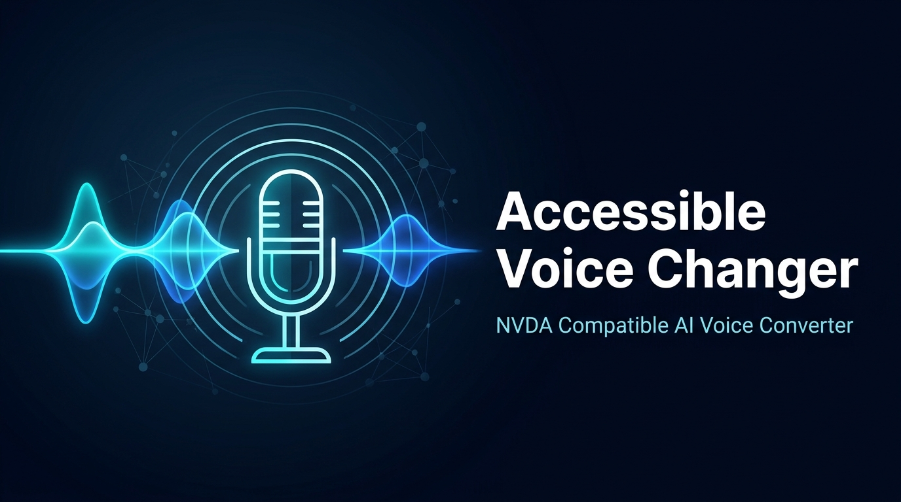

> 🌐 **[Türkçe Dokümantasyon (`readme_türkçe.md`)](readme_türkçe.md)** &nbsp;|&nbsp; 🏠 **[Home (`README.md`)](README.md)** &nbsp;|&nbsp; 🌍 **[Live Website](https://ali-ucel.github.io/erisilebilir-ses-degistirici/)**

# Accessible Voice Changer (v1.0.2)

**Accessible Voice Changer (NVDA Compatible RVC Voice Converter):**  
This application offers RVC (Retrieval-based Voice Conversion) artificial intelligence voice conversion technology with **100% keyboard and screen reader compatibility** for all users, especially individuals with visual impairments and those using screen readers such as NVDA.

Unlike typical voice changers with inaccessible interfaces, every menu, voice character slider, model browser, training wizard, audio separator, and setup prompt is designed from the ground up for effortless keyboard navigation and live screen reader feedback.

---

## 🚀 Direct Download

Download the latest installer package directly:

👉 **[Accessible Voice Changer Setup (Download v1.0.2)](https://github.com/ali-ucel/erisilebilir-ses-degistirici/releases/latest/download/Erisilebilir_Ses_Degistirici_Kurulumu.exe)**  
*(File Size: ~203 MB | 64-bit Windows 10/11)*

---

## ✨ Key Features

* **🌍 25 Application Languages & 18-Language Setup Wizard (New!):**
  * Automatically detects your Windows display language on first launch (falls back cleanly to English if your system language is not in the list).
  * Supported UI languages: English, Turkish, German, French, Spanish, Italian, Portuguese, Russian, Arabic, Japanese, Korean, Chinese (Simplified & Traditional), Swedish, Norwegian, Danish, Finnish, Hungarian, Bulgarian, Greek, Hindi, Vietnamese, Azerbaijani, Kazakh, and Uzbek.
  * Switch the application language anytime from the Settings menu.
  * The Inno Setup wizard opens with a full 18-language selector, localized prompts, and NVDA/SAPI spoken guidance.

* **♿ 100% NVDA & Screen Reader Accessibility:**
  * Fully accessible wxPython interface.
  * Live spoken status and action announcements via NVDA Controller Client (with SAPI fallback).
  * Complete keyboard control (`Tab`, `Arrow Keys`, `Space`, `Enter`, `Esc`, and function key shortcuts).
  * Audio beep cues and spoken progress updates.

* **🎙️ Live Microphone Conversion:**
  * Low-latency real-time RVC v2 voice alteration.
  * NVIDIA GPU (CUDA) hardware acceleration (~100–150ms latency) plus optimized CPU fallback mode.
  * Virtual Audio Cable (`Line 1`) routing and headphone monitoring support.

* **🎚️ Voice Character Settings:**
  * Gain, output volume, pitch shift, and millimeter-level formant fine-tuning.
  * Effortlessly transform vocal timbre across ranges while preserving natural inflection and speech clarity.

* **☁️ Open Source Model Pool (690+ Models):**
  * Instant access and one-click download for over 690 AILabTürkiye and popular RVC voice models directly inside the application.

* **🎓 Model Training Wizard (Single & Batch):**
  * Step-by-step training of AI voice models from your own voice recordings (Automatic saving every 10 epochs).
  * Supports **Train Single Model** and **Batch Model Training (Up to 3 Models)**.
  * **Text-to-Speech (TTS) Dialog:** Choose between typing text directly or selecting a `.txt` document.

* **✂️ Song & Sound Effect Separator (Demucs AI Integration):**
  * Prompts you in the Model Training Wizard whenever you select an audio file to optionally remove background music and sound effects.
  * Fast vocal/instrumental separation powered by Demucs AI (GPU or CPU).
  * Fully accessible **Preview Window** to listen to isolated vocals or background effects and pass clean vocals straight into training.
  * Also available standalone from the main screen and Settings menu.

* **🧹 Safe Upgrade & Previous Version Cleanup:**
  * When an existing installation is detected, the setup wizard explicitly asks for your confirmation before cleaning old application files while preserving your trained models and personal settings.

* **🎮 Gaming, Discord & Streaming Ready:**
  * Works seamlessly with Discord, TeamSpeak, CS2, Valorant, GTA V, RDR2, Twitch, OBS, and any voice chat via Virtual Audio Cable (`Line 1`).

---

## ⌨️ Keyboard Shortcuts

* **F1:** Help & User Guide
* **F2:** Add Local Voice Model
* **F3:** Train AI Voice Model Wizard
* **F5:** Start / Stop Live Voice Conversion
* **F6:** Test Voice Recording
* **F7:** Start / Stop Output Audio Recording

---

## 🧠 What Is RVC (Retrieval-based Voice Conversion)?

### 1. Deep-Learning Voice Conversion
**Retrieval-based Voice Conversion (RVC)** is a modern neural voice conversion architecture. Rather than simply shifting frequencies like traditional pitch filters, it extracts pure phonetic content (`ContentVec` / `HuBERT`), captures live pitch contours (`RMVPE`, `FCPE`, or `Harvest`), matches acoustic vectors against a **FAISS `.index`** database of the target speaker, and synthesizes natural audio via **VITS / HiFi-GAN**.

### 2. Why It Sounds Natural
* Preserves pronunciation, pacing, emotion, and intonation.
* Eliminates the robotic or "chipmunk" artifacts produced by traditional frequency-shift filters.

---

## 💻 System Requirements

| Component | Minimum | Recommended |
| :--- | :--- | :--- |
| **Operating System** | Windows 10 (64-bit) | Windows 11 (64-bit) |
| **Processor (CPU)** | Intel Core i5 / AMD Ryzen 5 | Intel Core i7 / AMD Ryzen 7 |
| **Graphics (GPU)** | CPU Mode Supported | NVIDIA RTX 3060 or newer (CUDA) |
| **Memory (RAM)** | 8 GB RAM | 16 GB RAM or higher |
| **Storage** | 2 GB free disk space | SSD (for fast model loading) |
| **Audio Device** | Standard Microphone + Headphones | Line 1 (Virtual Audio Cable) |

---

## 🛠️ Setup & Quick Start

1. Download **[Accessible Voice Changer Installer](https://github.com/ali-ucel/erisilebilir-ses-degistirici/releases/latest/download/Erisilebilir_Ses_Degistirici_Kurulumu.exe)**.
2. Run the setup wizard, choose your preferred installer language, and follow the accessible prompts.
3. Open the **"Accessible Voice Changer (NVDA)"** shortcut created on your desktop.
4. Configure your devices in the main window:
   * **Input Device:** Select your microphone.
   * **Output Device:** Select `Line 1 (Virtual Audio Cable)`.
   * **Monitor Output:** Select your headphones.
   * **Voice Model:** Pick a voice model from the list.
5. Press **F5** to start live voice conversion!

---

## ❓ FAQ

**Q: How do friends hear my converted voice on Discord?**  
*A: Set your Input Device in Discord > Settings > Voice & Video to `Line 1 (Virtual Audio Cable)`.*

**Q: Can I monitor my own converted voice in real time?**  
*A: Yes, check the headphone monitoring option ("Hear My Own Voice") in the main window.*

**Q: Does it work without an NVIDIA GPU?**  
*A: Yes. If no CUDA-capable NVIDIA GPU is detected, the app switches to optimized CPU mode. Because real-time neural synthesis performs heavy tensor math, CPU mode introduces higher latency (500ms–1s+); an NVIDIA GTX/RTX GPU is strongly recommended for smooth, low-latency gaming and streaming.*

---

## 👤 Developer & Contact

* **Developer:** Ali Ücel
* **Email:** [aliucel2011@gmail.com](mailto:aliucel2011@gmail.com)
* **GitHub:** [@ali-ucel](https://github.com/ali-ucel)

*All distribution and intellectual property rights belong to Ali Ücel.*
