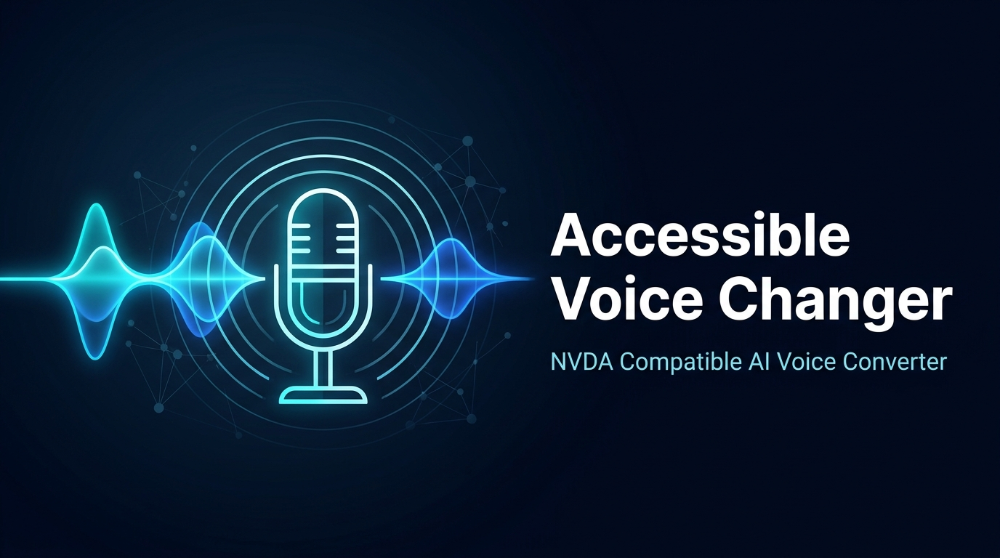

> 🌐 **[English Documentation (`readme_en.md`)](readme_en.md)** &nbsp;|&nbsp; 🏠 **[Ana Sayfa (`README.md`)](README.md)** &nbsp;|&nbsp; 🌍 **[Web Sitesi](https://ali-ucel.github.io/erisilebilir-ses-degistirici/)**

# Erişilebilir Ses Değiştirici (v1.0.2)

**Erişilebilir Ses Değiştirici**, görme engelli bireyler başta olmak üzere tüm kullanıcılar için tasarlanmış, **%100 NVDA ve ekran okuyucu uyumlu**, yapay zeka (RVC v2) destekli gerçek zamanlı bir ses dönüştürme yazılımıdır.

Diğer karmaşık, ekran okuyucularla okunamayan ses değiştiricilerin aksine; tüm menüler, ses ayarları, model seçimleri, eğitim sihirbazı ve kurulum adımları tamamen klavye ve ekran okuyucu dostu olarak geliştirilmiştir.

---

## 🚀 Doğrudan İndirme

Son sürüm kurulum paketini aşağıdaki bağlantıdan tek tıkla indirebilirsiniz:

👉 **[Erişilebilir Ses Değiştirici Kurulumu (v1.0.2 İndir)](https://github.com/ali-ucel/erisilebilir-ses-degistirici/releases/latest/download/Erisilebilir_Ses_Degistirici_Kurulumu.exe)**  
*(Dosya Boyutu: ~203 MB | 64-bit Windows Destekli)*

---

## ✨ v1.0.2 ve Öne Çıkan Özellikler

* **🌍 25 Dilde Uygulama Arayüzü ve 18 Dilli Kurulum Sihirbazı (Yeni!):**
  * Uygulama ilk açılışta Windows arayüz dilini otomatik algılar; desteklenen 25 dil dışında bir dil kullanılıyorsa otomatik olarak İngilizce ile açılır.
  * Desteklenen uygulama dilleri: Türkçe, İngilizce, Almanca, Fransızca, İspanyolca, İtalyanca, Portekizce, Rusça, Arapça, Japonca, Korece, Çince (Basitleştirilmiş ve Geleneksel), İsveççe, Norveççe, Danca, Fince, Macarca, Bulgarca, Yunanca, Hintçe, Vietnamca, Azerbaycanca, Kazakça ve Özbekçe.
  * Ayarlar menüsünden uygulama dilini dilediğiniz zaman değiştirebilirsiniz.
  * Kurulum sihirbazı 18 dilde seçim ekranı, yerelleştirilmiş tüm uyarı kutuları ve NVDA/SAPI sesli kurulum yönlendirmesi sunar.

* **♿ %100 NVDA ve Ekran Okuyucu Erişilebilirliği:**
  * wxPython altyapısıyla geliştirilmiş tam erişilebilir kullanıcı arayüzü.
  * NVDA Controller Client entegrasyonu ile anlık sesli durum ve işlem bildirimleri.
  * Klavyeden `Tab`, `Yön Tuşları`, `Boşluk` ve `Enter` ile eksiksiz kontrol.
  * İşlem adımları için sesli bip ve durum bildirimleri.

* **🎙️ Canlı Mikrofon Dönüşümü (RVC v2):**
  * RVC v2 (Retrieval-based Voice Conversion) mimarisi ile düşük gecikmeli gerçek zamanlı ses dönüştürme.
  * NVIDIA GPU (CUDA) donanım hızlandırması (~100-150ms) ve CPU destekli çalıştırma modu.
  * Virtual Audio Cable (`Line 1`) ve kulaklık izleme (monitör) desteği.

* **🎚️ Ses Karakter Ayarları (Formant, Perde ve Kazanç):**
  * Kazanç, ses seviyesi, perde (pitch) ve milimetrik formant ince ayarı.
  * Formant kaydırma özelliğiyle erkek sesini kadın veya çocuk sesine, kadın sesini tok erkek sesine dönüştürebilme.

* **☁️ Açık Kaynak Model Havuzu (690+ Model):**
  * 690'dan fazla AILabTürkiye ve popüler RVC ses modeline uygulama içinden anında erişim ve tek tıkla indirme.

* **🎓 Gelişmiş Model Eğitim Sihirbazı (Tek ve Toplu Eğitim):**
  * Kendi ses kayıtlarınızdan adım adım yapay zeka ses modeli eğitimi (Her 10 epoch'ta otomatik kayıt).
  * **Tek Model Eğit** ve **Toplu Model Eğitimi (En Fazla 3 Model)** desteği.
  * **Metinden Sese (TTS) İletişim Kutusu:** Doğrudan metin yazma veya `.txt` dosyası seçerek sentezleme.

* **✂️ Şarkı ve Ses Efekti Ayırıcı (Demucs AI Entegrasyonu):**
  * Model eğitimi sihirbazında ses dosyası seçildiğinde arka plan müzik ve efektlerini ayırmak için açık onay sorusu.
  * NVIDIA GPU / CPU destekli Demucs AI modeliyle temiz vokal ayrıştırma.
  * Tam erişilebilir **Önizleme Penceresi**: Temiz vokali dinleme, ayrılan efektleri dinleme ve tek tıkla eğitime aktarma.
  * Ana ekranda ve Ayarlar menüsünde bağımsız *Şarkı / Efekt Ayırıcı* aracı.

* **🧹 Güvenli Kurulum ve Eski Sürüm Temizliği:**
  * Kurulum sihirbazı sistemde önceki bir sürüm tespit ettiğinde kullanıcıya açık onay sorar.
  * Onay verildiğinde eski sürüm kodları temizlenir; kullanıcının kendi eğittiği ses modelleri ve ayarları güvenle korunur.

* **🎮 Discord, Oyunlar ve Canlı Yayın Uyumu:**
  * Virtual Audio Cable (Line 1 / CABLE) desteğiyle Discord, TeamSpeak, CS2, Valorant, GTA V, RDR2 ve tüm sesli sohbetlerde anında çalışır.

---

## ⌨️ Klavye Kısayolları

* **F1:** Yardım ve Kullanım Rehberi
* **F2:** Bilgisayardan Ses Modeli Ekle
* **F3:** Yapay Zeka Ses Modeli Eğitim Sihirbazı
* **F5:** Canlı Ses Dönüştürmeyi Başlat / Durdur
* **F6:** Ses Test Kaydı Al
* **F7:** Çıktı Ses Kaydını Başlat / Durdur

---

## 🧠 Retrieval-based Voice Conversion (RVC) Nedir ve Ne İçin Kullanılır?

### 1. RVC (Retrieval-based Voice Conversion) Nedir?
**Retrieval-based Voice Conversion (RVC)**, derin öğrenme temelli en gelişmiş yapay zeka ses dönüştürme mimarisidir. Konuşmacının ses tonunu, boğaz rezonansını ve akustik özelliklerini alıp hedef bir kişinin veya karakterin ses tınısına dönüştürür. Söylenen kelimeleri, artikülasyonu, duyguyu, tonlamayı ve konuşma hızını birebir koruyarak yalnızca ses kimliğini (timbre) değiştirir.

### 2. Neden "Retrieval-based" (Geri Getirme Tabanlı) Olarak Adlandırılır?
Geleneksel yapay zeka ses dönüştürme modelleri yalnızca sinir ağı ağırlıklarına dayanır; bu durum uzun konuşmalarda veya yüksek perdelerde sesin metalikleşmesine yol açabilir. RVC ise:
* Model eğitilirken hedef sesin tüm akustik vektörlerini bir **FAISS** indeks dosyasında (`.index`) toplar.
* Konuşma sırasında gerçek zamanlı olarak fonetik özelliklerinize en yakın hedef ses vektörlerini bu indeksten **"geri getirir" (retrieve)**.
* Sonuç olarak pürüzsüz, çatallanmayan ve doğal bir ses elde edilir.

### 3. RVC Nasıl Çalışır? (Teknik Mimari)
1. **İçerik Ayrıştırma (Feature Extraction):** `ContentVec` veya `HuBERT` ile mikrofondan gelen sesin saf fonetik içeriği çıkarılır.
2. **Perde Algılama (Pitch Extraction / F0):** `RMVPE`, `FCPE` veya `Harvest` algoritmalarıyla sesinizin melodisi anlık olarak yakalanır.
3. **Vektör İndeks Eşleme (Feature Retrieval):** Çıkarılan fonetik özellikler `.index` dosyasındaki hedef konuşmacı vektörleriyle eşleştirilir.
4. **Nöral Ses Sentezi (VITS / HiFi-GAN):** Hedef konuşmacının ağırlıkları ve indeksten geri getirilen özellikler birleştirilerek ultra düşük gecikmeyle ses üretilir.

### 4. Geleneksel Ses Değiştiricilerden Farkı Nedir?
* **Geleneksel Filtreler:** Yalnızca ses frekansını yukarı/aşağı kaydırır (pitch shift); mekanik veya robotik bir ses üretir.
* **RVC Yapay Zeka Dönüşümü:** Ses tellerinin titreşimini, ağız-boğaz rezonans boşluğunu (formant) ve hedef konuşmacının doğal tınısını baştan sona yeniden modeller.

---

## 💻 Sistem Gereksinimleri

| Bileşen | Minimum | Önerilen |
| :--- | :--- | :--- |
| **İşletim Sistemi** | Windows 10 (64-bit) | Windows 11 (64-bit) |
| **İşlemci (CPU)** | Intel Core i5 / AMD Ryzen 5 | Intel Core i7 / AMD Ryzen 7 |
| **Ekran Kartı (GPU)** | CPU Modu Desteklenir | NVIDIA RTX 3060 veya üzeri (CUDA) |
| **Bellek (RAM)** | 8 GB RAM | 16 GB RAM veya üzeri |
| **Depolama** | 2 GB boş disk alanı | SSD (Hızlı model yükleme için) |
| **Ses Aygıtı** | Standart Mikrofon + Kulaklık | Line 1 (Virtual Audio Cable) |

---

## 🛠️ Kurulum ve Başlangıç

1. **[Erişilebilir Ses Değiştirici Kurulum Paketi](https://github.com/ali-ucel/erisilebilir-ses-degistirici/releases/latest/download/Erisilebilir_Ses_Degistirici_Kurulumu.exe)** dosyasını indirin.
2. Kurulum sihirbazını çalıştırın ve açılan ekrandan kurulum dilinizi seçip adımları takip edin.
3. Kurulum tamamlandığında masaüstünüzde oluşan **"Erişilebilir Ses Değiştirici (NVDA)"** kısayolunu açın.
4. Açılan arayüzde:
   * **Giriş Aygıtı:** Kendi mikrofonunuzu seçin.
   * **Çıkış Aygıtı:** `Line 1 (Virtual Audio Cable)` seçin.
   * **İzleme Çıkışı:** Kendi kulaklığınızı seçin.
   * **Ses Modeli:** Listeden konuşmak istediğiniz karakteri seçin.
5. **F5** tuşuna basarak canlı ses dönüştürücüyü başlatın!

---

## ❓ Sıkça Sorulan Sorular (SSS)

**S: Discord'da sesimin değiştiğini arkadaşlarım nasıl duyar?**  
*C: Discord > Ayarlar > Ses ve Görüntü bölümünden Giriş Aygıtını `Line 1 (Virtual Audio Cable)` yapmanız yeterlidir.*

**S: Kendi sesimi de kulaklığımdan duyabilir miyim?**  
*C: Evet, arayüzdeki "Kendi Sesimi Duy" onay kutusunu işaretlediğinizde dönüştürülen ses anlık olarak kulaklığınıza da gelir.*

**S: Ekran kartım AMD veya Intel, programı kullanabilir miyim?**  
*C: Evet, uygulama NVIDIA ekran kartı (CUDA) tespit edemezse otomatik olarak optimize edilmiş CPU moduna geçer. Ancak CPU üzerinde çok yoğun matris hesaplamaları nedeniyle gecikme (500ms–1sn+) artabilir; akıcı ve ultra düşük gecikmeli canlı oyun/yayın deneyimi için NVIDIA GTX/RTX ekran kartı önerilir.*

---

## 👤 Geliştirici & İletişim

* **Geliştirici:** Ali Ücel
* **E-Posta:** [aliucel2011@gmail.com](mailto:aliucel2011@gmail.com)
* **GitHub:** [@ali-ucel](https://github.com/ali-ucel)

*Bu yazılımın tüm dağıtım ve fikri hakları Ali Ücel'e aittir.*
